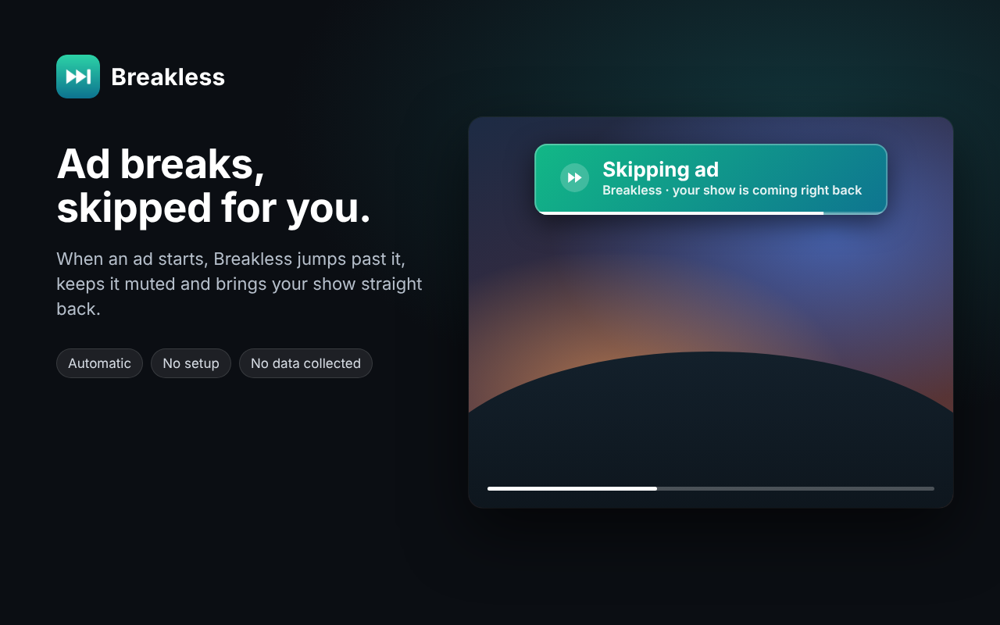

# Breakless

A browser extension that skips and removes ads in **movies and shows** on **Prime Video** and **JioHotstar**. The user installs it and it works; there is nothing to set up. Live sports are out of scope: during a live ad break it only mutes.

Works in Chrome, Edge, Brave and Opera (one build), and in Firefox 140+, including Firefox for Android 142+ (a second build).



## Install

One click from the store:

| Browser | Install |
|---|---|
| **Chrome, Brave** | **[Get Breakless on the Chrome Web Store](https://chromewebstore.google.com/detail/breakless/nnhpdkaghaokhcaaddjkplkefjdifdjg)** |
| **Microsoft Edge** | **[Get Breakless on Edge Add-ons](https://microsoftedge.microsoft.com/addons/detail/aokengnfpamoadclgmgcfjpodmcdcmkd)** |

A Firefox Add-ons version is on the way. Until then, Firefox users can use the zip and follow the steps under "Install it yourself" below.

| Browser | File |
|---|---|
| Firefox 140+ | [release/breakless-firefox-v0.2.0.zip](release/breakless-firefox-v0.2.0.zip) |
| Opera, or testing a local build | [release/breakless-chrome-edge-v0.2.0.zip](release/breakless-chrome-edge-v0.2.0.zip) |

**Not working on Edge?** Edge can install extensions with every site switched off. Open `edge://extensions` → Breakless → **Details** → **Site access**, switch on `primevideo.com`, `amazon.in`, `amazonvideo.com`, `aiv-delivery.net`, `hotstar.com` and `jiohotstar.com`, then reload the Prime Video or JioHotstar tab. The popup should say "Working on Prime Video".

## What it does

| Layer | Prime Video | JioHotstar | Default |
|---|---|---|---|
| Blocks ad network calls | `getVideoAds`, `getAds`, Amazon ad-video host | `preroll` / `midroll` calls, `videoads.hotstar.com`, `hesads.akamaized.net`, Google ad requests | On |
| Skips ads on screen | Reads the ad countdown, jumps past the ad (max 90 s per jump; Amazon's player crashes on bigger jumps), clicks Amazon's Skip button. With no countdown it plays the ad muted at 16x. | Ends separately played ad videos; jumps past ads shown with an "Ad" badge countdown | On |
| Hides ad slots | – | Ad billboards (`bbtype-video` / `bbtype-image`) | On |
| Cleans page data | – | Removes the player's `intervention_data` | On |
| Removes ads before they load (**beta**) | Strips ad Periods from the DASH manifest, ad cue points and pause ads from the playback data, and the ad-insertion request flags. Same rules as uBlock Origin. | – | **Off** |

While an ad is handled, a large highlighted **"Skipping ad"** card appears at the top of the player, with a progress bar. When the ad is gone it turns into a green **"Ad skipped"** for 1.6 s. The card scales with the player, up to 26 px text in full screen.

**How the skip works**
1. Breakless reads the countdown and jumps past the ad, at most 90 s per jump. Bigger jumps crash Amazon's player.
2. It checks that the jump actually landed by reading the video's own position, not the on-screen countdown, which can lag while the player buffers.
3. It falls back to muted 16x only when there is no countdown, when the player snaps back after the jump, or when the countdown stops moving after a jump.
4. Ad breaks longer than 90 s get a second jump, but only if the countdown is clearly still counting down.

Sound and speed come back as soon as the ad ends. Product videos on Amazon shopping pages are never touched.

## Install it yourself (for testing)

**Chrome / Edge / Brave**
1. Download and unzip `breakless-chrome-edge-v0.2.0.zip` into a folder.
2. Open `chrome://extensions` (on Edge: `edge://extensions`).
3. Turn on **Developer mode** and click **Load unpacked**.
4. Select the unzipped folder, then pin the extension from the puzzle-piece menu.

**Firefox**
1. Open `about:debugging#/runtime/this-firefox`.
2. Click **Load Temporary Add-on** and choose `manifest.json` inside the unzipped Firefox folder.
3. Firefox removes temporary add-ons when it closes. For a permanent install, publish to Firefox Add-ons (AMO).

## Getting it to non-technical users (one-click install)

They can only install it with one click from a store:

| Store | Cost | Notes |
|---|---|---|
| Chrome Web Store | One-time US$5 developer fee | **Live:** [Breakless on the Chrome Web Store](https://chromewebstore.google.com/detail/breakless/nnhpdkaghaokhcaaddjkplkefjdifdjg). Covers Chrome and Brave users. |
| Microsoft Edge Add-ons | Free | **Live:** [Breakless on Edge Add-ons](https://microsoftedge.microsoft.com/addons/detail/aokengnfpamoadclgmgcfjpodmcdcmkd) |
| Firefox Add-ons (AMO) | Free | Upload the Firefox zip. Also reaches Firefox for Android. |

**Store listing tips**
- Keep "Prime Video" and "Hotstar" **out of the name**. "Works with Prime Video and JioHotstar" in the description is the safer form.
- Logo, tiles, screenshots and the listing text are in `store-assets/` (see `store-assets/STORE_LISTING.md`). To re-render the images: `node tools/render-store-assets.js store-assets/popup.png`.

## Before publishing: test on the real sites

Everything was tested in Chrome against **mock** pages that copy the ad signals known from public sources (see `test/`). The real sites can differ, so test them yourself:

1. Load the extension, open Prime Video and JioHotstar, and play a movie or show until an ad break.
2. Press F12, open **Console**, and set the level filter to include **Verbose**. Filter by `Breakless`.
3. Lines like `prime ad break started (29s left)`, `jumped 28.0s` and `ad break ended` mean it is working. `player refused the jump` or `countdown frozen` explain any fast-forwarding you see.
4. If an ad plays and nothing is logged, right-click the "Ad" countdown on screen, choose **Inspect**, and note its element and class names. That is the selector to add to `TIMER_SELECTORS` in `src/content/prime.js` (or to `hotstar.js`).

## Project layout

```
src/
  manifest.json           MV3 manifest (Chrome build; build.js derives the Firefox one)
  background.js           turns rule sets on/off from the popup toggles
  rules/*.json            declarativeNetRequest rules (prime_basic, prime_preload, hotstar_basic)
  content/shared.js       settings, ad controller (jump / mute / 16x / restore), on-player toast
  content/prime.js        Prime ad detection on screen
  content/prime-main.js   page-context: manifest + playback-data pruning (beta)
  content/hotstar.js      Hotstar ad-video / badge handling, billboard hiding
  content/hotstar-main.js page-context: intervention_data pruning
  popup/                  toggles + "ad breaks handled" counter
build.js                  -> dist/chrome, dist/firefox and both zips
release/                  ready-to-install zips
store-assets/             store logo, tiles, screenshots, listing text
test/                     mock pages, local HTTPS server, end-to-end test in real Chrome
```

## Build and test

```bash
npm install
node build.js                   # builds dist/ and the zips
bash test/setup-fixtures.sh     # one-time: test video + self-signed cert (needs ffmpeg, openssl)
sudo node test/run.js           # needs Chrome; binds port 443; maps all hosts to 127.0.0.1
```

`test/run.js` expects Chrome at `/usr/bin/google-chrome`; edit `executablePath` there if yours is elsewhere. Last run: **34/34 passed** (Chrome 153). Includes a player that refuses jumps, a 150 s ad break, and a countdown that freezes after the first jump.

## Known limits

- **Changing selectors.** Amazon A/B-tests the class names, so detection can break after a player update. The text fallback ("Ad 0:20" inside the player) and the 16x fallback reduce this risk but don't remove it.
- **JioHotstar signals are less certain.** The 2026 web player's ad elements aren't publicly documented. The badge and ad-video signals come from community code; test them on the live site.
- **Beta mode** can make subtitles drift (seen with uBlock Origin's identical rules). That is why it is off by default.
- **Account risk.** Hotstar's terms forbid blocking ads, and one unconfirmed report links an ad blocker to a blocked account. Mention this in your store listing or FAQ.

## Privacy

Breakless collects nothing. See [PRIVACY.md](PRIVACY.md).

---

Breakless is an independent project and is not affiliated with, endorsed by or sponsored by Amazon or JioStar. Product names are used only to describe compatibility.
